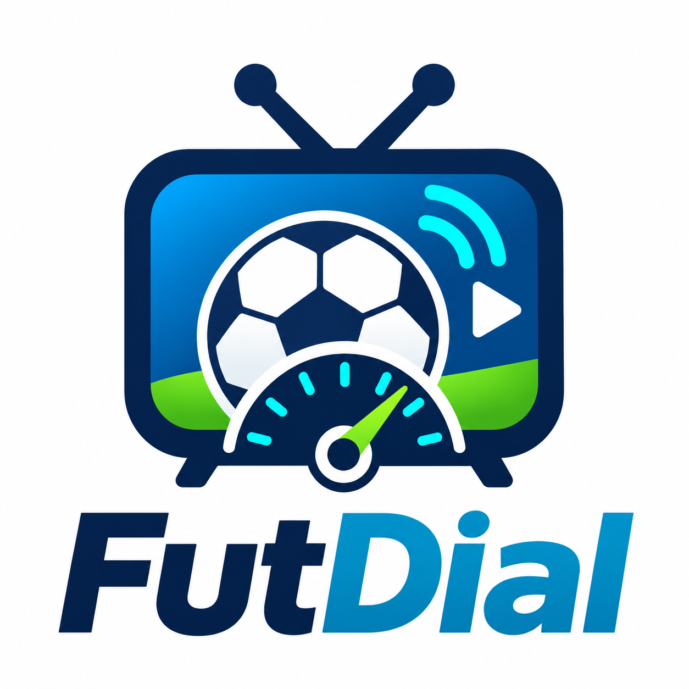

<p align="center">
  
</p>

# FutDial

[](https://hacs.xyz/docs/faq/custom_repositories)
[](https://github.com/jgsaez9/futdial/actions/workflows/validate.yml)
[](https://github.com/jgsaez9/futdial/releases)

Integración para **Home Assistant** que te dice **en qué canal y número de dial de Movistar Plus+** se emite un partido de fútbol:

> **Atleti Barça** → `M+ LALIGA - 54`

Usa la guía de programación oficial de Movistar Plus+ (la misma que la web/app), así que cubre todos los canales: M+ LALIGA, DAZN LALIGA, LALIGA TV HYPERMOTION, M+ Liga de Campeones, M+ Vamos, Primera Federación, Teledeporte, La 1, TV3…

## Qué incluye

| Entidad / servicio | Para qué sirve |
| --- | --- |
| `sensor.futdial_proximo_partido_<equipo>` | Canal y dial del próximo partido de cada equipo que sigas: `M+ LALIGA - 54`. |
| `sensor.futdial_dial_<equipo>` | Sólo el número del dial: `54`. Atributos `fecha` (`08/11/2026`), `hora` (`21:00`), `fecha_hora` (`domingo 08/11/2026 a las 21:00`), `partido`, `canal`… |
| `sensor.futdial_fecha_partido_<equipo>` | Fecha y hora de inicio (sensor de tipo *timestamp*, ideal para automatizaciones). |
| `text.futdial_buscar_partido` | Escribe un equipo o partido (p. ej. `Atleti Barça`). |
| `sensor.futdial_resultado_busqueda` (+ `_dial` y `_fecha`) | Lo mismo que los tres sensores de equipo, para lo que hayas escrito en la búsqueda. |
| `sensor.futdial_partidos_hoy` | Número de partidos que quedan hoy, con la lista completa (hora, partido, canal y dial). |
| `futdial.buscar_partido` | Servicio con respuesta, para scripts y automatizaciones. |
| `futdial.actualizar` | Fuerza la descarga de la guía. |
| Intent de Assist | «¿En qué canal echan el Atleti?» → «Atlético de Madrid - FC Barcelona (LALIGA EA SPORTS) se emite hoy a las 20:54 en M+ LALIGA (dial 54).» |

Por defecto sólo se tienen en cuenta las emisiones **en directo / estreno** (no repeticiones, diferidos de madrugada ni resúmenes). La hora es la de inicio en la parrilla de Movistar, que suele ser unos minutos antes del pitido inicial. Si un partido se emite en varios canales a la vez, aparecen todos (`M+ Vamos - 11, M+ Liga de Campeones - 60`).

La búsqueda ignora mayúsculas y acentos y entiende apodos habituales: `Atleti`, `Barça`, `Depor`, `Juve`, `PSG`, `United`… Si buscas un club, el primer equipo tiene prioridad sobre el femenino o el filial salvo que lo pidas (`Barcelona femenino`, `Castilla`).

## Instalación (HACS)

1. En Home Assistant abre **HACS → ⋮ → Repositorios personalizados**.
2. Añade `https://github.com/jgsaez9/futdial` con el tipo **Integración**.
3. Busca **FutDial** en HACS, pulsa **Descargar** y reinicia Home Assistant.
4. Ve a **Ajustes → Dispositivos y servicios → Añadir integración → FutDial**.

[](https://my.home-assistant.io/redirect/hacs_repository/?owner=jgsaez9&repository=futdial&category=integration)

Cuando se publique una versión nueva, HACS la mostrará como actualización disponible.

### Instalación manual

Copia `custom_components/futdial` en la carpeta `config/custom_components/` de tu Home Assistant y reinicia.

## Configuración

Todo se configura desde la interfaz (y se puede cambiar después en **Configurar**):

- **Equipos a seguir**: lista con los 20 equipos de LALIGA EA SPORTS, los 22 de LALIGA HYPERMOTION, la Selección y los grandes de Europa. También puedes escribir cualquier otro equipo o competición. Cada equipo crea tres sensores (canal, dial y fecha).
- **Actualizar la programación**: cada 30 min, cada hora, 2, 3, 6 o 12 horas, una vez al día, cada 2 o 3 días o una vez a la semana. Si eliges varios días, se descarga la programación suficiente para cubrir hasta la siguiente actualización.
- **Días de programación** (1–7, por defecto 3).
- **Incluir repeticiones y resúmenes**.
- **Buscar en todos los canales**: por defecto sólo se consultan los ~65 canales donde se emite fútbol (Movistar Plus+, DAZN, LALIGA TV, generalistas y autonómicos): unos 4 MB por día en lugar de 11 MB y cuatro veces más rápido.

La programación se guarda en disco. Al arrancar Home Assistant, FutDial carga al instante lo que ya tenía y **no descarga nada mientras HA arranca**: espera a que termine y sólo descarga si, según el intervalo elegido, ya toca. La primera vez, los sensores aparecen en estado «desconocido» y se rellenan en unos segundos. Si falla la conexión, se mantienen los datos que había y se reintenta cada 5 minutos.

### ¿Hace falta reiniciar al actualizar?

Sí. Home Assistant carga el código de las integraciones una sola vez, al arrancar, y no permite sustituirlo en caliente (la opción «Recargar» de la integración vuelve a leer la configuración, pero con el código antiguo). Por eso HACS pide reiniciar tras cualquier actualización de una integración. Basta con **Ajustes → Sistema → ⏻ → Reiniciar Home Assistant** (no hace falta reiniciar el equipo) y, gracias a la caché, FutDial vuelve a tener sus datos al momento.

Para ver cuánto tarda en arrancar cada integración: **Ajustes → Sistema → Reparaciones → ⋮ → Tiempos de inicio de integraciones**.

Los equipos se reconocen comparando cada lado del partido, así que «FC Barcelona» no confunde al Espanyol de Barcelona ni «Racing de Santander» al Racing de Ferrol, y los partidos del femenino, filial o juvenil no cuentan como del primer equipo.

Requiere Home Assistant 2024.11 o posterior.

> **Logo:** a partir de Home Assistant 2026.3 el logo aparece en *Ajustes → Dispositivos y servicios* una vez instalada la integración y reiniciado HA. En la lista de HACS se verá un icono genérico: HACS sólo carga iconos del repositorio central de *brands*, que ya no admite integraciones personalizadas.

## Ejemplos

### Script que pregunta y notifica

```yaml
script:
  donde_echan_partido:
    fields:
      equipo:
        example: "Atleti"
    sequence:
      - action: futdial.buscar_partido
        data:
          partido: "{{ equipo }}"
        response_variable: r
      - action: notify.mobile_app_mi_movil
        data:
          title: "{{ r.resultado or 'Sin emisión' }}"
          message: "{{ r.texto }}"
```

Respuesta del servicio:

```yaml
consulta: Atleti Barça
encontrado: true
resultado: M+ LALIGA - 54
canal: M+ LALIGA
dial: 54
inicio: "2026-11-08T20:54:00+01:00"
fecha: 08/11/2026
hora: "20:54"
fecha_hora: domingo 08/11/2026 a las 20:54
texto: Atlético de Madrid - FC Barcelona (LALIGA EA SPORTS) se emite hoy a las 20:54 en M+ LALIGA (dial 54).
partidos:
  - partido: Atlético de Madrid - FC Barcelona
    competicion: LALIGA EA SPORTS
    canal_dial: M+ LALIGA - 54
    todos_los_canales: M+ LALIGA - 54
    cuando: hoy a las 20:54
    en_juego: false
```

### Aviso 15 minutos antes del partido de tu equipo

```yaml
automation:
  - alias: Aviso partido Atleti
    triggers:
      - trigger: time
        at:
          entity_id: sensor.futdial_fecha_partido_atletico_de_madrid
          offset: "-00:15:00"
    actions:
      - action: notify.mobile_app_mi_movil
        data:
          title: "¡Empieza el partido! Dial {{ states('sensor.futdial_dial_atletico_de_madrid') }}"
          message: "{{ state_attr('sensor.futdial_proximo_partido_atletico_de_madrid', 'texto') }}"
```

### Tarjeta Markdown con los partidos de hoy

```yaml
type: markdown
title: ⚽ Fútbol hoy en Movistar Plus+
content: |
  
  {{ '🔴' if p.en_juego else '🕒' }} **{{ p.hora }}** {{ p.partido }} — `{{ p.todos_los_canales }}`
  
  No quedan partidos hoy.
  
```

### Buscador en el panel

```yaml
type: entities
entities:
  - entity: text.futdial_buscar_partido
  - entity: sensor.futdial_resultado_busqueda
    secondary_info: last-changed
```

## Poner el partido en la tele

FutDial puede marcar el dial en el descodificador de Movistar Plus+ usando cualquier entidad `remote` de Home Assistant (Broadlink RM mini/RM4, Android TV Remote…).

1. **Ajustes → Dispositivos y servicios → FutDial → Configurar → Mando**.
2. Elige la entidad del mando (p. ej. `remote.rm_mini_3`), la pausa entre dígitos y cómo se envían los números:
   - **Códigos IR por dígito**: pega el código de cada tecla del 0 al 9, tal cual lo usas en `remote.send_command` (con o sin `b64:`). Sólo hacen falta los dígitos de los diales que vayas a usar.
   - **Plantilla de comando**: `{digito}` se sustituye por cada número. Por ejemplo `{digito}` con dispositivo `movistar` para comandos aprendidos en Broadlink llamados `0`…`9`, o `KEYCODE_{digito}` para Android TV.

Con el mando configurado tendrás:

| | |
| --- | --- |
| `button.futdial_poner_partido_<equipo>` | Un botón por equipo seguido: pone el canal de su próximo partido. |
| `button.futdial_poner_resultado_busqueda` | Pone el canal de lo que hayas escrito en «Buscar partido». |
| `futdial.sintonizar` | Acción con `partido: Atleti` o `dial: 54`. |
| Voz | «Pon el partido del Atleti» → «Pongo Atlético de Madrid - FC Barcelona en M+ LALIGA, dial 54». |

```yaml
action: futdial.sintonizar
data:
  partido: Atleti
```

Si el descodificador se salta dígitos, sube la pausa. Si al marcar un dial con dos dígitos iguales (p. ej. `55` o `11`) sólo cambia con uno, súbela también: algunos descodificadores toman dos pulsaciones idénticas muy seguidas como una sola tecla mantenida.

## Asistente de voz (Assist)

Copia [`custom_sentences/es/futdial.yaml`](custom_sentences/es/futdial.yaml) a `/config/custom_sentences/es/futdial.yaml` y reinicia. Después podrás preguntar:

- «¿En qué canal echan el Atleti?»
- «¿Dónde ponen el Betis Sevilla?»
- «¿Qué dial es el partido del Barça?»
- «Pon el partido del Atleti» / «Sintoniza el Betis» (con el mando configurado)

Si usas un agente de conversación con LLM, el intent `FutDialBuscarPartido` también queda disponible como herramienta.

## Publicar una versión nueva (para el mantenedor)

1. Sube `version` en `custom_components/futdial/manifest.json` (p. ej. `1.0.1`).
2. Haz commit y push a `main`.
3. Crea y sube el tag con la misma versión: `git tag v1.0.1 && git push origin v1.0.1`.

La acción *Release* crea la release de GitHub automáticamente y HACS la ofrecerá como actualización.

## Aviso

Proyecto no oficial, sin relación con Telefónica ni Movistar Plus+. Los datos proceden de la guía pública de programación y pueden cambiar sin aviso. Los diales son los de Movistar Plus+ por fibra/IPTV en España.
